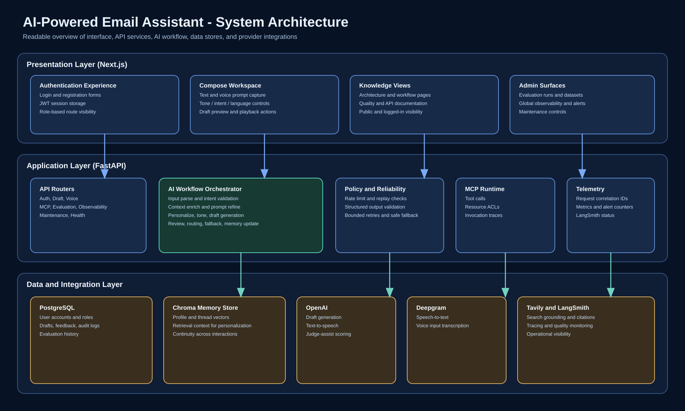
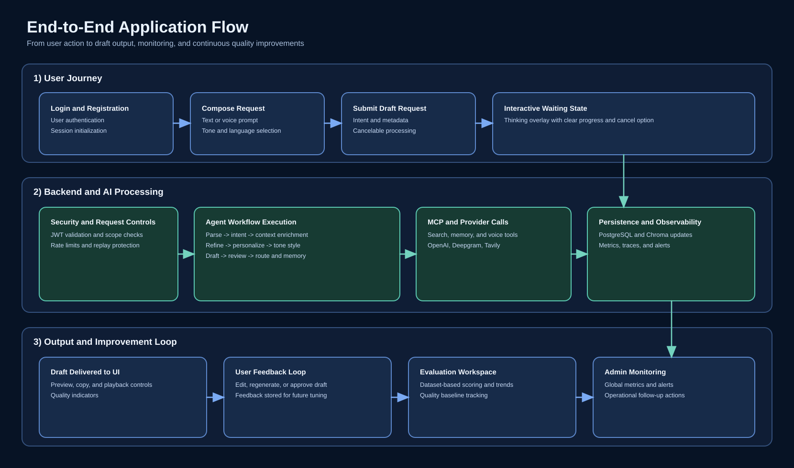
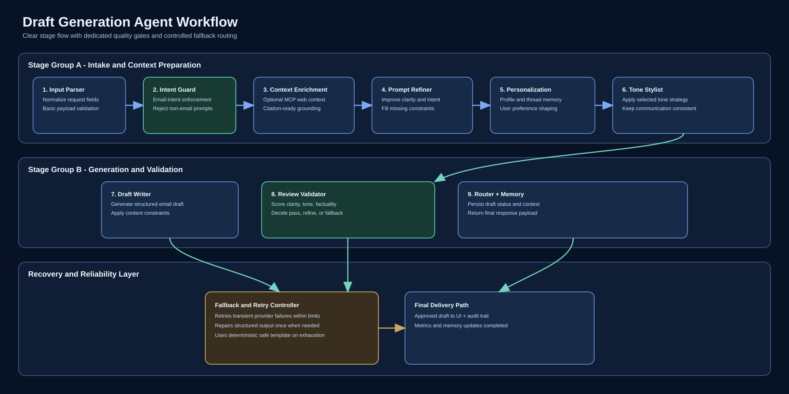
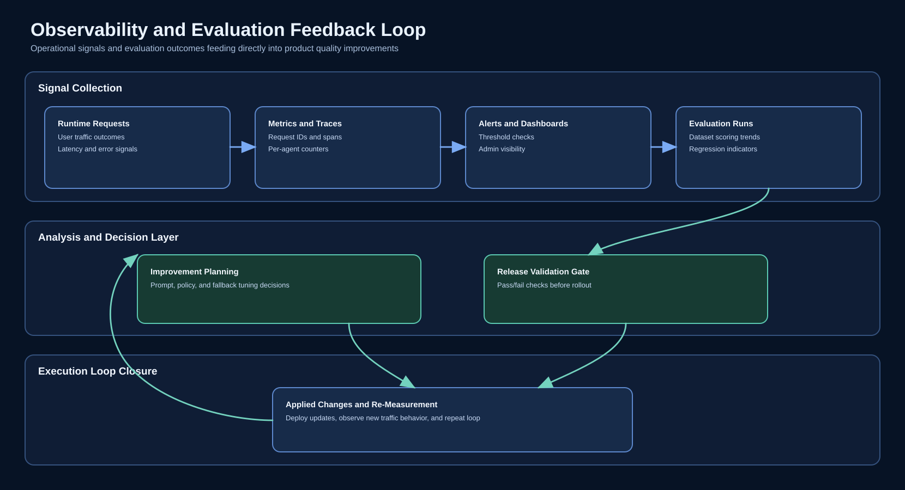

# AI-Powered Email Assistant

[](https://github.com/shashankd02/email-draft-assistant/actions/workflows/ci.yml)
[](https://github.com/shashankd02/email-draft-assistant/actions/workflows/pr-review-agent.yml)
[](https://github.com/shashankd02/email-draft-assistant/actions/workflows/stale.yml)

A full-stack email drafting application that helps users create clear, tone-aware emails from text or voice input.

`spec_dev.md` is the source of truth for architecture and implementation decisions.

## What This Project Delivers
- Guided email drafting flow with strict intent validation
- Multi-stage AI workflow for prompt improvement, personalization, and quality checks
- Voice and text input options
- Clear user/admin separation for operational views
- Built-in observability and evaluation surfaces

## Architecture Visuals

### System Architecture


### End-to-End Request Flow


### Agent Workflow


Agent workflow source: `diagrams/agent-workflow.svg`

### Observability + Evaluation Loop


Diagram sources (`.svg`) are in `diagrams/`.

## Technology Stack
| Layer | Technologies |
|---|---|
| Frontend | Next.js 14, React, TypeScript |
| Backend | FastAPI, Python |
| Data | PostgreSQL, Chroma |
| AI Providers | OpenAI, Deepgram, Tavily |
| Observability | LangSmith (optional), in-app metrics/alerts |
| DevOps | Docker Compose, GitHub Actions |

## AI Workflow Stages
1. Input Parser
2. Intent Guard
3. Context Enrichment
4. Prompt Refiner
5. Personalization
6. Tone Stylist
7. Draft Writer
8. Review Validator
9. Router + Memory

## Application Pages
- Web App: `http://localhost:3000`
- Compose: `http://localhost:3000/compose`
- Architecture: `http://localhost:3000/architecture`
- Architecture Map: `http://localhost:3000/architecture-map`
- Workflows: `http://localhost:3000/workflows`
- Quality: `http://localhost:3000/quality`
- API Docs (UI): `http://localhost:3000/docs`
- Swagger (backend): `http://localhost:8002/docs`

## Quick Start
### Prerequisites
- Docker Desktop (or Docker Engine + Compose plugin)
- Available ports: `3000`, `5432`, `8001`, `8002`

### 1) Configure environment files
```bash
cp backend/.env.example backend/.env
cp frontend/.env.local.example frontend/.env.local
```

### 2) Add required keys in `backend/.env`
- `OPENAI_API_KEY`
- `DEEPGRAM_API_KEY` (recommended for voice transcription)
- `TAVILY_API_KEY` (for context enrichment)
- `LANGSMITH_API_KEY` (optional)

### 3) Start the application
```bash
make start
```

### 4) Open and use
Go to `http://localhost:3000`, register/login, and generate drafts.

## Docker Command Reference
- Start detached + migrate: `make start`
- Start in foreground: `make up`
- Run migrations only: `make migrate`
- View logs: `make logs`
- Stop containers (keep volumes): `make stop`
- Full reset (remove volumes): `make reset`

## Build, Test, and Quality Signals
CI is configured in `.github/workflows/ci.yml` and runs:
- Backend migrations, compile, tests, evaluation smoke, security scans
- Frontend install, lint, and build
- Containerized smoke flow for auth + draft + MCP endpoints

Additional automation:
- PR structural review agent: `.github/workflows/pr-review-agent.yml`
- Stale issue/PR management: `.github/workflows/stale.yml`
- CODEOWNERS enforcement: `.github/CODEOWNERS`

## Main API Groups
- Auth: `/api/v1/auth/*`
- Drafting: `/api/v1/draft/*`
- Voice: `/api/v1/voice/*`
- MCP: `/api/v1/mcp/*`
- Evaluation (admin): `/api/v1/evaluation/*`
- Observability (admin): `/api/v1/observability/*`
- Health: `/api/v1/health`

Auth note:
- Self-registration supports `user` and `admin` in development mode.
- Admin self-registration is blocked outside development mode.
- Bootstrap token endpoint (`/api/v1/auth/token`) is intended for development mode only.

## Repository Structure
- `backend/`: APIs, agents, services, DB models, migrations, tests
- `frontend/`: pages, components, styles, client integrations
- `diagrams/`: architecture and workflow assets (`.svg` + `.png`)
- `docs/`: assignment/reference documents
- `spec_dev.md`: architecture blueprint and requirements baseline

## Quick Troubleshooting
- Port conflict (`EADDRINUSE`): free the port or run Docker-only (`make start`)
- Draft/API failures: verify `OPENAI_API_KEY` in `backend/.env`, then restart
- Services not healthy after config changes: run `make stop` then `make start`
- Need clean state: run `make reset`, then `make start`

## Demo Script (Evaluator-Friendly)
1. Open `http://localhost:3000` and show login/register.
2. Login as a regular user and open `Compose`.
3. Enter a valid email intent prompt, pick tone/language, and generate a draft.
4. Show draft output actions: preview, copy, and playback.
5. Enter a non-email prompt to demonstrate intent guard behavior.
6. Open `Architecture` and `Workflows` pages to explain system and agent flow.
7. Login as admin and show `Observability` + `Evaluation` pages.
8. Open Swagger at `http://localhost:8002/docs` and show core endpoints.
